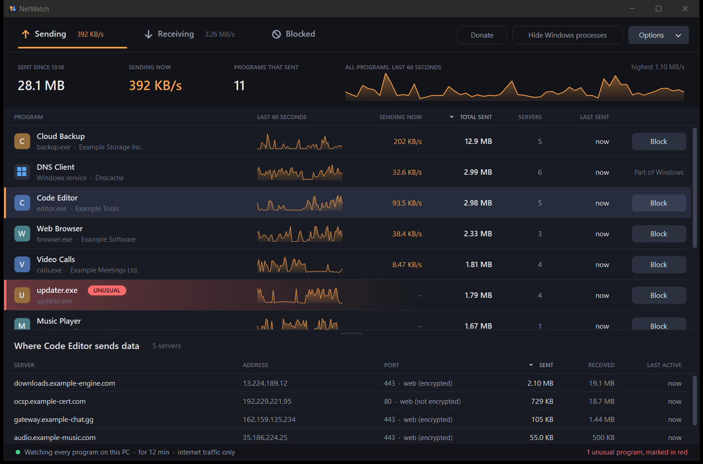
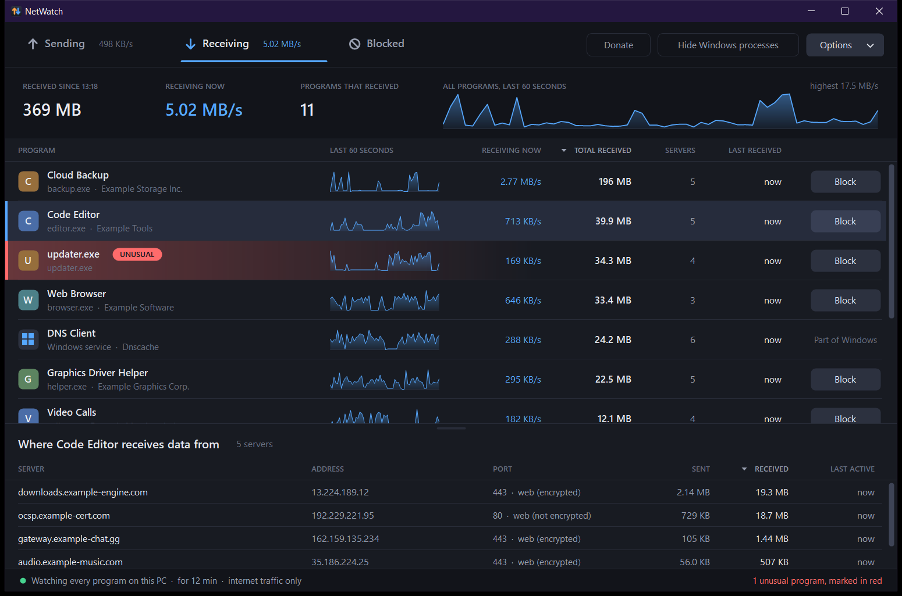

# NetWatch

**See which programs on your PC send and receive data: how much, and to which servers.**

Free, open source, no ads, no tracking, no account. NetWatch itself sends nothing anywhere.



*The pictures on this page use made-up example programs and numbers.*

## What it does

- **Sending and Receiving tabs.** Every program that used the network: speed right now, total, a
  60-second chart, how many servers it talked to, and when it was last active.
- **Where the data goes.** Click a program to list the servers it talks to, with readable names
  (`api.example.com`), not just numbers.
- **Block a program.** One button adds an ordinary Windows Firewall rule; the Blocked tab undoes it.
  Nothing is ever blocked unless you press Block and confirm.
- **Hide Windows' own processes** with one click, so only the programs you installed remain.
- **Unusual programs glow red.** See [below](#the-red-unusual-mark) for exactly what that means.
- **Sort** any list by clicking a column title.

## Install

### Windows 10 / 11

1. Download **`NetWatchSetup.exe`** from the [latest release](https://github.com/Mohenni/NetWatch/releases/latest).
2. Run it and press Install.

Good to know:

- **Windows will warn you** ("Windows protected your PC" / "Unknown publisher"). NetWatch is not
  code-signed, because a certificate costs money every year. Choose *More info* → *Run anyway*, or
  don't trust the download at all and [build it yourself](#build-it-yourself) in ten seconds.
- **NetWatch asks for administrator permission each time it starts.** Windows only tells
  administrators which program sends what; there is no way around that question.
- The release files are built by GitHub from this source code (see `.github/workflows/release.yml`),
  not uploaded by hand. `SHA256SUMS.txt` lists their checksums.
- Remove it again under *Settings → Apps*. The uninstaller offers to remove your blocks as well.

### Linux and macOS

A smaller edition that shows the same lists in a page in your own browser. It is a single Python
file and needs nothing but Python 3.7+ and tools that are already part of the system.

```sh
git clone https://github.com/Mohenni/NetWatch.git
cd NetWatch
sh install.sh
netwatch
```

or, without git:

```sh
curl -fsSL https://raw.githubusercontent.com/Mohenni/NetWatch/main/install.sh | sh
```

The installer copies one file to `~/.local/share/netwatch` and adds the command `netwatch` in
`~/.local/bin`. Remove it with `sh install.sh --uninstall`.

**Please read before relying on it:**

| | Windows | Linux | macOS |
|---|---|---|---|
| Per-program totals | TCP + UDP | TCP only | TCP + UDP |
| Servers per program | yes, with names | yes, addresses only | no |
| Blocking | yes | no | no |
| How it counts | every packet, reported by Windows | sampled once a second with `ss` | sampled every 2 s with `nettop` |
| Tested | by hand on real traffic, against the network adapter's own counters | only by an automatic check on GitHub's Linux machines (current result: *Actions* tab) | only by an automatic check on GitHub's macOS machines (current result: *Actions* tab) |

- Because the Linux/macOS edition *samples*, a connection that opens and closes within a second can
  be missed. Treat its numbers as a good overview, not as an exact meter.
- On Linux, `netwatch` asks for your password (sudo) so that it can see the programs of all users.
  `netwatch --no-sudo` shows only your own.
- It was written without access to a Linux or macOS desktop. If something looks wrong on your
  machine, please [open an issue](https://github.com/Mohenni/NetWatch/issues).

## The red "UNUSUAL" mark



NetWatch marks a program when a few plain facts about its file look out of place. On Windows:

- it uses the name of a Windows program (`svchost.exe`, `explorer.exe` …) but is not in the Windows folder, or
- its digital signature is broken (the file was changed after its maker signed it), or
- it has no digital signature **and** either runs from a temporary / download folder or does not
  say what it is and who made it, or
- it closed before NetWatch could see which file it was.

On Linux and macOS: it runs from a temporary or download folder, or its program file was deleted
while it is still running.

**This is a hint, not a virus scan.** A marked program is not necessarily harmful, and an unmarked
one is not guaranteed to be safe. Hover over the name to read the reason, then decide for yourself.

## How it works

On Windows, NetWatch reads the same information Resource Monitor uses: Event Tracing for Windows
(ETW). Three built-in providers are switched on while NetWatch is open:

| Provider | Used for |
|---|---|
| `Microsoft-Windows-Kernel-Network` | bytes sent / received per process and remote address |
| `Microsoft-Windows-Kernel-Process` | process start / stop, so short-lived programs still get a name |
| `Microsoft-Windows-DNS-Client` | which host name an address belongs to |

No driver is installed, nothing is injected into other programs, and packet contents are never read,
only *how much* and *where to*.

A few honest details:

- Counting starts when you open NetWatch and stops when you close it. There is no background service.
- Windows hands the figures over up to about three seconds late, so totals trail the real traffic by a moment.
- By default only internet traffic is counted. Traffic inside your home network can be added under *Options*.
- Blocking uses path-based firewall rules (rule group "NetWatch"). Programs that move to a new folder
  when they update themselves (Discord, Teams …) need to be blocked again after an update.
- Parts of Windows itself have no Block button; blocking them would cut the whole PC off.
- To name servers that no program looked up while NetWatch was open, it can ask your normal DNS
  server (a "reverse lookup"). That is the only network traffic NetWatch ever causes, and it can be
  switched off under *Options*.

## Build it yourself

Windows needs no extra tools: the build uses the C# compiler that ships with every Windows 10/11.

```bat
git clone https://github.com/Mohenni/NetWatch.git
cd NetWatch
build.bat
```

This produces `bin\NetWatch.exe` (the program) and `NetWatchSetup.exe` (the installer).

The source is plain C# 5 / WinForms on .NET Framework 4.8, with no third-party libraries:

```
src/App      the program (capture engine, bookkeeping, window)
src/Shared   look and feel, firewall rules (shared with the installer)
src/Setup    the installer / uninstaller
unix/        the Linux / macOS edition (one Python file)
```

Useful switches for developers: `NetWatch.exe --demo` (made-up traffic, no administrator rights),
`--selftest <folder>` (drives the window by itself and saves pictures), `--diag <file>` (writes a
text report every ten seconds).

## Licence

[MIT](LICENSE). Use it, change it, share it.
